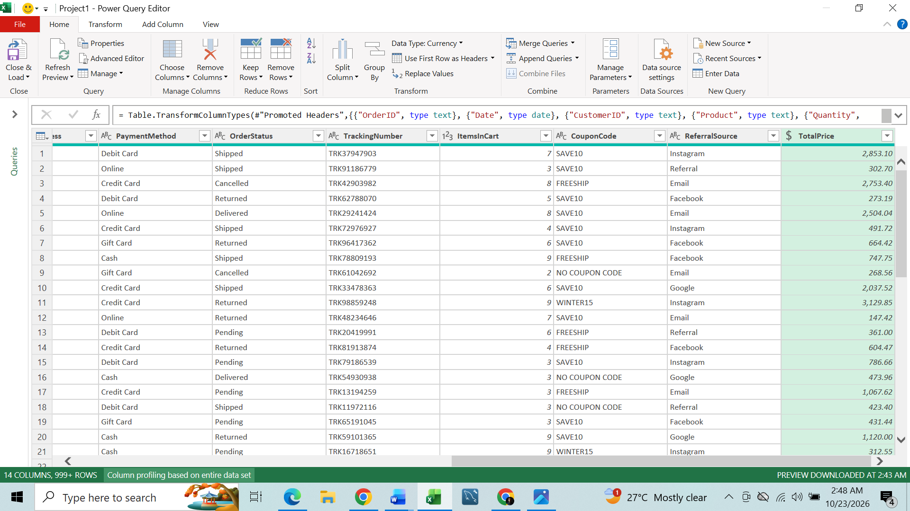
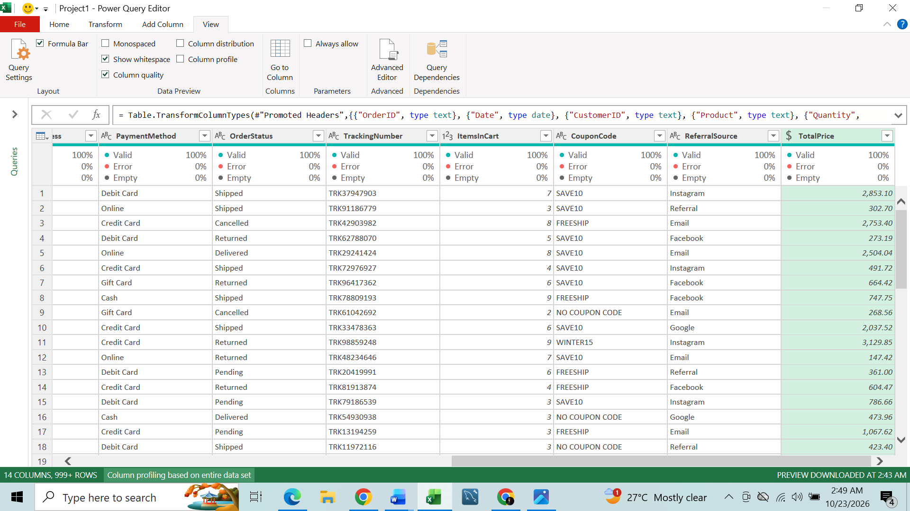
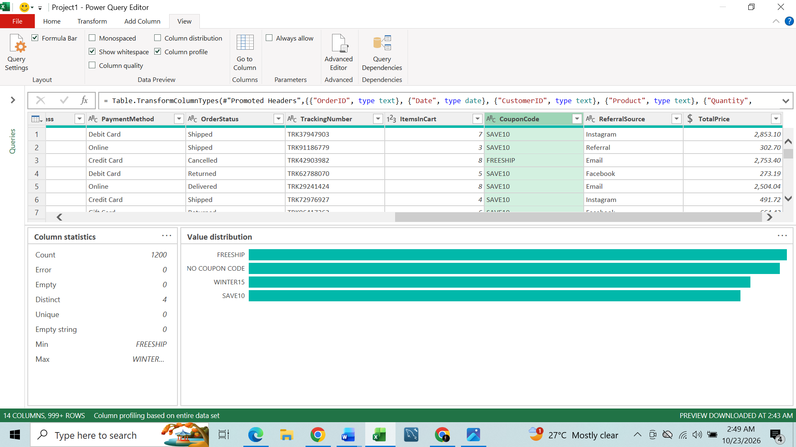

## 📊 Project 1 - Data cleaning

The quality of any analysis depends on the quality of the data behind it. I recently completed my first data cleaning project as an intern at Decodelabs, working with a retail sales dataset of 𝟏,𝟐𝟎𝟎-𝖗𝖔𝖜𝖘 𝖆𝖓𝖉 𝟏𝟒-𝖈𝖔𝖑𝖚𝖒𝖓𝖘 in Microsoft Excel Power Query.

𝐃𝐀𝐓𝐀 𝐄𝐗𝐏𝐋𝐎𝐑𝐀𝐓𝐈𝐎𝐍  I examined the structure in Power Query. Columns like OrderId, Product, Quantity, and TotalPrice showed me this was a retail sales record covering orders, payments, and shipping. 

𝐖𝐡𝐲 𝐢𝐭 𝐦𝐚𝐭𝐭𝐞𝐫𝐬  Context shows how variables relate and which cleaning operations are appropriate. 

𝐈𝐃𝐄𝐍𝐓𝐈𝐅𝐘𝐈𝐍𝐆 𝐔𝐍𝐈𝐐𝐔𝐄 𝐂𝐎𝐋𝐔𝐌𝐍𝐒  Using Column Distribution, I found that OrderId and TrackingNumber held unique values, making them potential record identifiers. 

𝐖𝐡𝐲 𝐢𝐭 𝐦𝐚𝐭𝐭𝐞𝐫𝐬  This helps catch duplicates and prevent double-counting. But uniqueness alone doesn’t make a primary key. The identifier must also be complete. 

𝐃𝐀𝐓𝐀 𝐓𝐘𝐏𝐄𝐒 𝐀𝐍𝐃 𝐅𝐎𝐑𝐌𝐀𝐓𝐓𝐈𝐍𝐆  I verified that every column had the correct data type, then formatted UnitPrice and TotalPrice as currency to two decimal places.

𝐖𝐡𝐲 𝐢𝐭 𝐦𝐚𝐭𝐭𝐞𝐫𝐬  Correct types ensure accurate calculations, and consistent formatting makes reports easier to read. 

𝐕𝐀𝐋𝐈𝐃𝐀𝐓𝐈𝐍𝐆 𝐓𝐎𝐓𝐀𝐋𝐏𝐑𝐈𝐂𝐄  I created a custom column that multiplied Quantity by UnitPrice, then compared the result to the recorded TotalPrice. Any row where the two didn’t match was flagged for review.

𝐖𝐡𝐲 𝐢𝐭 𝐦𝐚𝐭𝐭𝐞𝐫𝐬  TotalPrice drives revenue analysis. If it’s wrong, every sales figure built on it is wrong too. 

𝐂𝐎𝐍𝐒𝐈𝐒𝐓𝐄𝐍𝐂𝐘 𝐀𝐍𝐃 𝐖𝐇𝐈𝐓𝐄𝐒𝐏𝐀𝐂𝐄  I checked Product, PaymentMethod, OrderStatus, and ReferralSource for inconsistent values and stray spaces. 

𝐖𝐡𝐲 𝐢𝐭 𝐦𝐚𝐭𝐭𝐞𝐫𝐬  “Completed” and “ Completed “ look identical but group separately. Standardizing text keeps reports accurate. 

𝐌𝐈𝐒𝐒𝐈𝐍𝐆 𝐕𝐀𝐋𝐔𝐄𝐒  Column Quality showed CouponCode had 309 missing values, 26% of the 1,200 records. Rather than deleting them, I considered the business context: some customers simply buy without a coupon. I replaced missing values with "NO COUPON CODE" using the power query's Conditional Column.

𝐖𝐡𝐲 𝐢𝐭 𝐦𝐚𝐭𝐭𝐞𝐫𝐬  Deleting those rows would have cost roughly 26% of the dataset, including valuable sales transactions. 

## 💡 Features skills

- Microsoft Excel  
- Power Query - ETL 
- EDA
