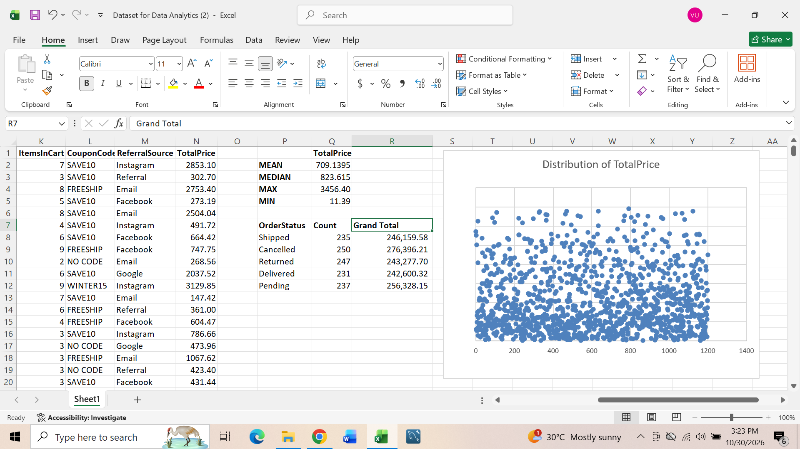
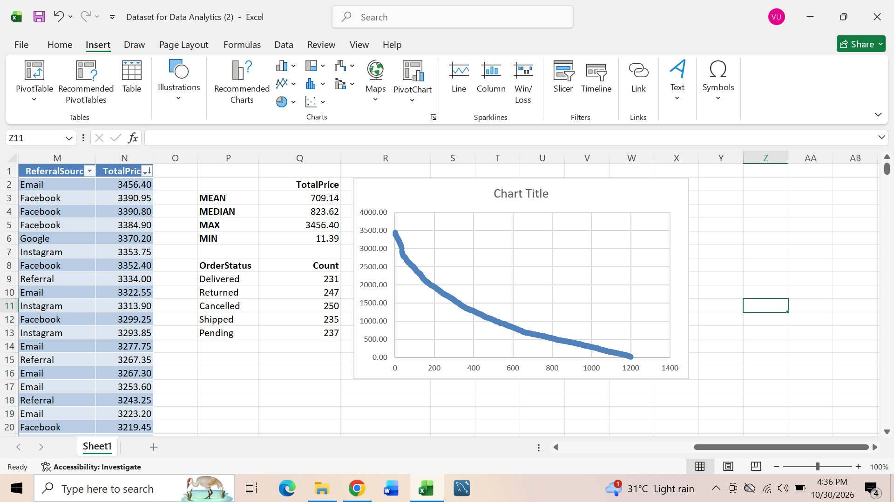
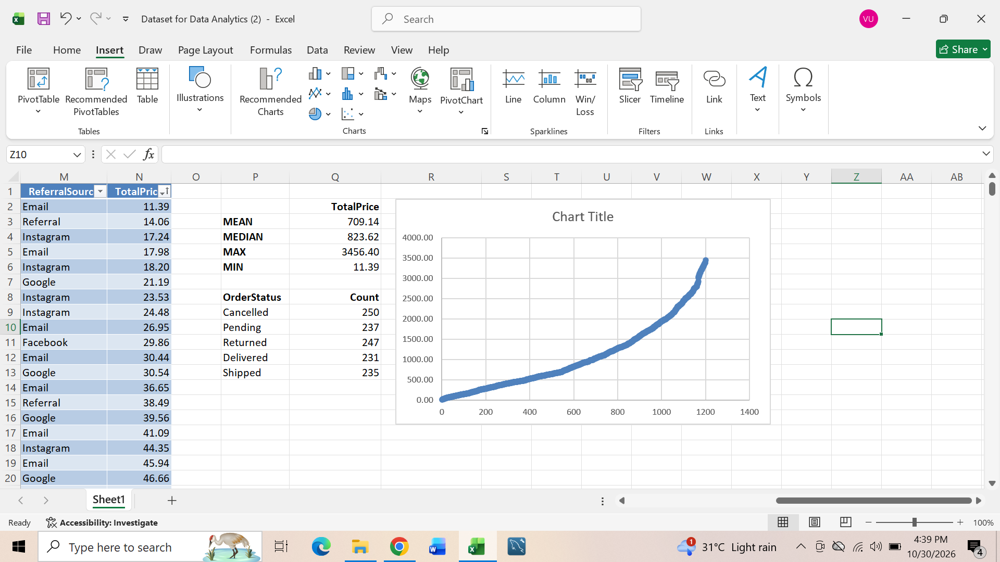

# 📊 Turning raw data into meaningful business insights

I worked on an order dataset containing 1,200 records. My goal was to explore the data, identify patterns, uncover potential issues, and extract insights that could support better business decisions.

Here are some interesting findings from my analysis:

## Order Status Analysis
I used the Excel formula to examine the distribution of orders across five different statuses - 𝐂𝐚𝐧𝐜𝐞𝐥𝐥𝐞𝐝, 𝐑𝐞𝐭𝐮𝐫𝐧𝐞𝐝, 𝐏𝐞𝐧𝐝𝐢𝐧𝐠, 𝐒𝐡𝐢𝐩𝐩𝐞𝐝 𝐚𝐧𝐝 𝐃𝐞𝐥𝐢𝐯𝐞𝐫𝐞𝐝.
One interesting observation was that cancelled orders had the highest frequency, while delivered orders had the lowest.
This raised questions about possible cancellation reasons and opportunities to improve order fulfilment.

## Understanding Sales Distribution Through Statistics
I calculated key statistical measures for the TotalPrice column such as 𝗠𝗘𝗔𝗡, 𝗠𝗘𝗗𝗜𝗔𝗡 etc
Comparing the mean and median revealed an interesting pattern. The mean was lower than the median, suggesting a potentially negatively skewed distribution.
This helped me understand why relying on the average alone might not give a complete picture of customer spending behaviour.

## Investigating Potential Outliers
One important part of my analysis was investigating whether unusually high or low values in the TotalPrice column could be potential outliers. Before flagging any value, I considered five important factors:

- **Deviation from the Mean ** I examined how far individual order values were from the average of 709.14. Values significantly distant from the average deserved further investigation.

- **Comparison with the Median ** I compared the mean (709.14) with the median (823.62). The difference suggested that the distribution might be negatively skewed, with relatively low values pulling the average downward.

- **Visual Distribution ** I created a scatter plot to examine how TotalPrice values were distributed across the 1,200 records. I paid attention to observations that appeared unusually distant from the main concentration of values.

- **Sorting the Values ** I sorted the TotalPrice column from smallest to largest to examine the distribution of order values. This helped me identify unusually low and high transactions and observe how values were spread across the dataset.

An unusually high or low value does not automatically qualify as an outlier and in this case it can also be influenced by several factors such as quantity or the unit price.

## 💡 Features skills

- Microsoft Excel  
- EDA