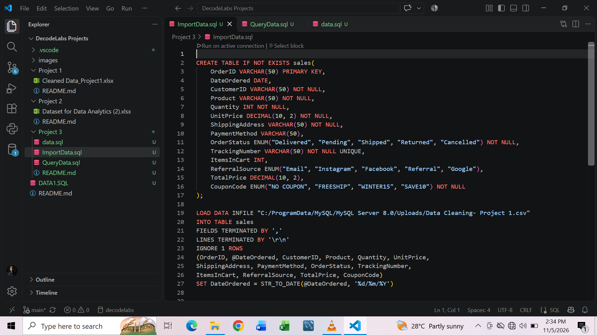
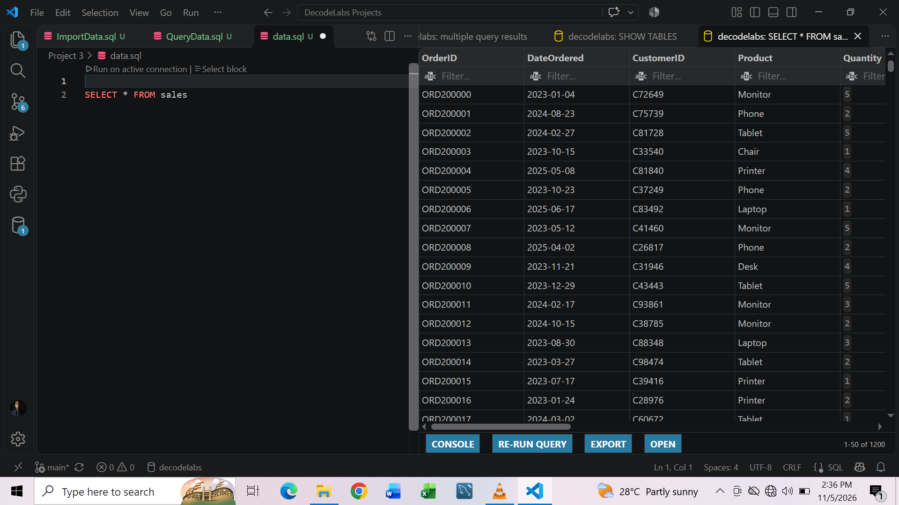
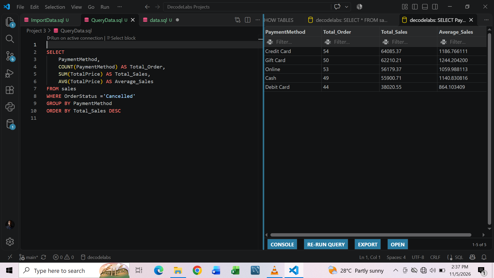

# 📊 Turning raw data into meaningful business insights - SQL

As a Data Analysis Intern at Decodelabs, I recently completed a sales data analysis project using MySQL.

# Here’s how I approached it:
**Database Creation:** Designed a sales table, defining appropriate data types, primary keys, unique constraints, and other data requirements.

**Data Importation:** Imported the cleaned sales dataset from a CSV file into MySQL, ensuring dates were properly converted.

**Data Analysis:** Used SQL queries to explore sales performance, applying aggregate functions such as COUNT(), SUM(), and AVG().

**Insights:** Analyzed cancelled orders by payment method, comparing order counts, total sales, and average sales.