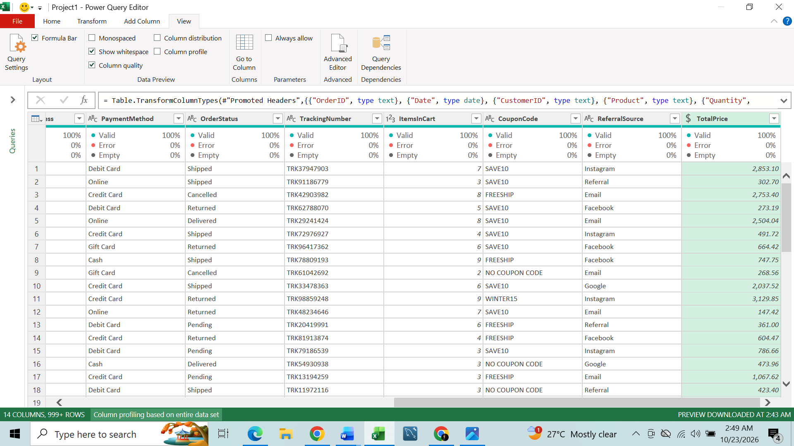
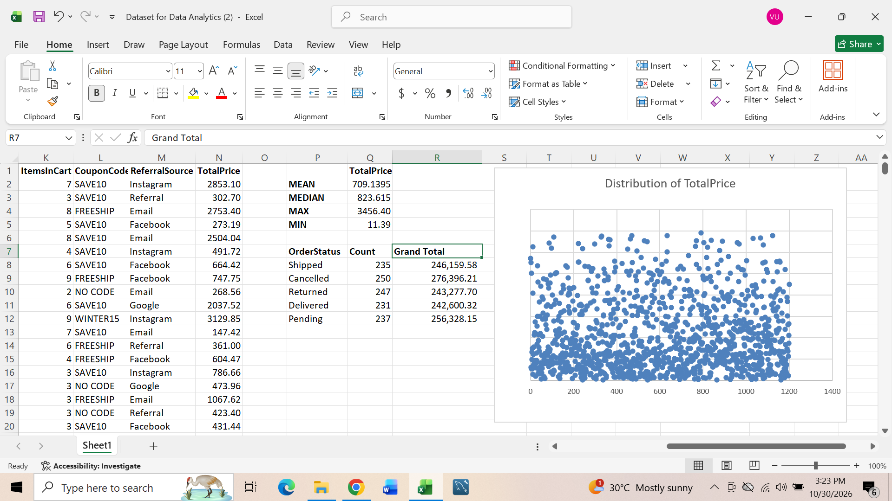

# 📊 My Data Analytics Internship Projects

This repository is a collection of all projects I completed as an intern at Decode Labs. It tracks my journey in using Excel, Power Bi and SQL for Data cleaning, exploratory data analysis (EDA) or ETL etc. all aimed in turning data into clear actionable insights.

# Featured Projects

Each has it own dedicated Readme with more details.

## 📊 Project 1 - Data cleaning 

### 𝕿𝖍𝖊 𝖌𝖔𝖆𝖑:
Find and fix data quality issues so the data was consistent, reliable, and ready for analysis.

### 𝕸𝖞 𝖇𝖎𝖌𝖌𝖊𝖘𝖙 𝖙𝖆𝖐𝖊𝖆𝖜𝖆𝖞: 
Data cleaning isn’t just fixing errors. It’s understanding the business context and applying the right transformation to improve quality without losing valuable information.

## 📊 Project 2 - Exploratory Data Analysis

### 𝕿𝖍𝖊 𝖌𝖔𝖆𝖑:
Explore data, identify patterns, uncover potential issues, and extract insights that could support better business decisions.

### 𝕸𝖞 𝖇𝖎𝖌𝖌𝖊𝖘𝖙 𝖙𝖆𝖐𝖊𝖆𝖜𝖆𝖞: 
Data analysis goes beyond cleaning datasets, calculating figures, and creating charts. The real value lies in understanding what the numbers are telling us.
 
